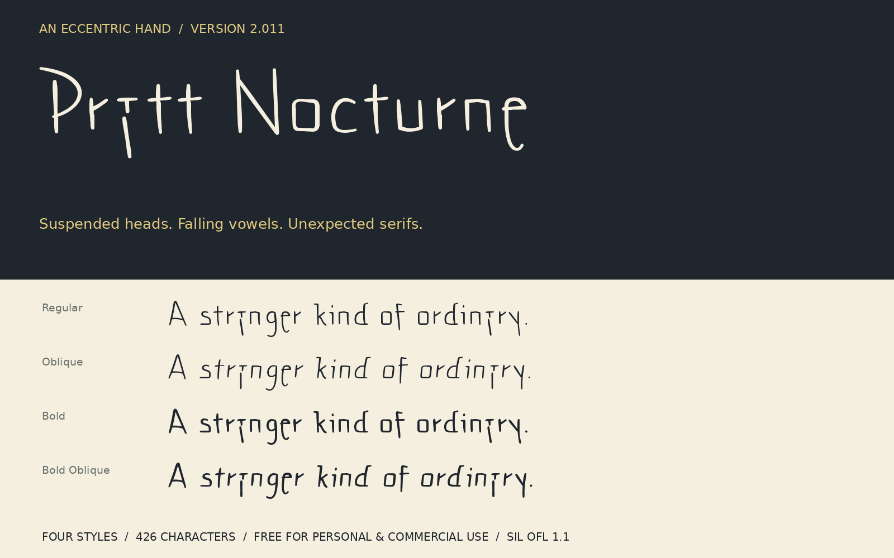

# Pratt Nocturne

An expressive handwriting-inspired display family with suspended letter heads, descending vowels, boxy curves and deliberately uneven construction.

This font was inspired by the unique handwriting in a letter I received many years ago. I liked the odd style so much that I created this font in order to preserve it. I find the lower case A irreconcilable. In addition to the swooping D, the sagging e, and the halfway constructed R, it is the reason I can't get the author's letter forms out of my mind even after so long. I hope you enjoy Pratt-Nocturne.

**Version 2.011 · Regular · Bold · Oblique · Bold Oblique**

## Download

[**Download the four desktop fonts (TTF)**](https://github.com/mkrzywonski/pratt-nocturne-font/releases/latest/download/Pratt-Nocturne-2.011-Desktop-TTF.zip) · [All release downloads](https://github.com/mkrzywonski/pratt-nocturne-font/releases/latest) · [Short specimen](specimens/Public-Specimen.pdf)

The desktop ZIP contains the fonts, installation instructions, OFL license, font history and a short specimen. OTF and self-hosted WOFF2 packages are also available. Install one desktop format.

## Fonts and proofs

- [Font files](fonts/): TTF and OTF for desktop use; WOFF2 for websites.
- [Complete character and exemplar proof](specimens/Complete-Exemplar-Proof.pdf): all 426 encoded characters and 62 additional glyphs, in all four styles, with isolated handwritten exemplars where available.
- [Approved K, ? and @ proof](specimens/Final-Forms.pdf): both families in all four styles.
- [b/d serif detail](specimens/Stem-Details.pdf): the mirrored stem details and inherited d forms.
- [Family proof](specimens/Release-2.011.pdf): style comparison and character inventory.
- [Interactive specimen](specimens/Try-Pratt-Nocturne.html): download the repository and open this file locally.
- [Exact character inventory](CHARACTER-SET.txt) and [validation results](VALIDATION.txt).

Install the four TTF files **or** the four OTF files, not both formats. Select **Pratt Nocturne** in your application. Bold and Italic controls select the companion faces; the supplied slanted styles are named Oblique and Bold Oblique. Restart applications after installation if necessary. Applications handle underlining.

## Design

The lowercase **a** has a tiny suspended T-shaped head and a detached descending slash. **e** has a closed eye and a long descent. **D** has an open crescent construction; **R** combines a projecting serif with a straight, slanted leg. Lowercase ascenders are short, and the **9** sits unusually low.

The obliques lean eight degrees, with individually adjusted sidebearings and transformed accent anchors. All four styles are static fonts. See [design notes](DESIGN-NOTES.md).

## Coverage

Each style contains **426 encoded characters and 488 glyphs**:

- Printable ASCII, full Latin-1 Supplement and Latin Extended-A.
- Romanian comma-below letters, capital sharp S and a dotted-circle fallback.
- Publishing punctuation, curly and low quotes, guillemets, dashes, primes, daggers, section and paragraph marks.
- Common currency and mathematical symbols, copyright, registered and trademark signs.
- Common vulgar fractions and all superscript/subscript digits.
- Fifteen combining accents with base and mark-to-mark positioning, spacing accents and typographic spaces.

This is a Latin display family. Greek, Cyrillic and comprehensive Vietnamese coverage are outside this release. Inferred characters extend the design vocabulary; they are not claimed as observed handwriting.

## OpenType features

| Feature | Behavior |
| --- | --- |
| kern | Selected optical spacing pairs |
| ss02 | Readable, d-derived a and q (including accented a, æ and ª) |
| calt | Alternate second letters in adjacent aa, ee and rr |
| ss01 | Amplified a, e, r and D |
| ccmp, mark, mkmk | Accent compositions, attachment and stacking |
| sups, subs, numr, dnom | Small digit forms |
| frac | Common sequences such as 1/2, 3/4 and 1/10 |

Enable frac only on fraction text; it is not an arbitrary-fraction formatter. Feature support varies by application. Precomposed accented characters work without mark positioning. Supported precomposed Latin accents shape equivalently in NFC and decomposed NFD.

Best for titles, poetry, correspondence and short expressive passages, starting around 24–36 pt. Allow generous line spacing for accents and deep descenders. There is no manual small-size hinting, and application coverage has not been exhaustively tested.

## Build

On NixOS or another system with Nix:

    nix-shell source/shell.nix --run 'python source/build.py'
    nix-shell source/shell.nix --run 'python source/release_proof.py'
    nix-shell source/shell.nix --run 'python source/exemplar_proof.py'
    nix-shell source/shell.nix --run 'python source/validate.py'
    nix-shell source/shell.nix --run 'python source/public_specimen.py'
    nix-shell source/shell.nix --run 'python source/readable_proof.py'
    nix-shell source/shell.nix --run 'python source/final_forms_proof.py'
    nix-shell source/shell.nix --run 'python source/package_release.py'

Otherwise provide Python with FontTools, Pillow, Shapely, Brotli and ReportLab, plus HarfBuzz, OpenType Sanitizer and Fontconfig. Proof generators use DejaVu Sans for labels.

source/build.py contains the centerline drawings and outline builder. source/readable.py defines the approved readable alternates. source/repertoire.py adds extended characters, compositions, anchors and the oblique transformation. The builder constructs pressure-modulated strokes, unions overlaps, fits cubic Bézier outlines, and exports OTF, TTF and WOFF2. drawings.json, features.fea and outline-sheet.svg are generated outputs.

Style metadata follows the OpenType [OS/2 selection flags](https://learn.microsoft.com/en-us/typography/opentype/spec/os2#fsselection) and [name-table conventions](https://learn.microsoft.com/en-us/typography/opentype/spec/name).

## Source-image privacy

Only metadata-free, individual-character crops are included in source/exemplars/. The proof embeds those small images directly. Full documents, private transcriptions, addresses, source coordinates and historical drafts are excluded. The proof distinguishes direct exemplars, uncertain case assignments, related base forms and characters with no direct exemplar. Both font and proof generators work without access to the original documents.

## License

The fonts and original design data use **SIL Open Font License 1.1**, with **no Reserved Font Names**. Build and proof program logic uses **MIT**. See [licensing scope](LICENSING.md), [OFL.txt](OFL.txt) and [LICENSE-MIT.txt](LICENSE-MIT.txt).

### Readable forms

Enable **Readable a and q** (`ss02`) to use the approved d-derived bowls.
The readable a has no upper serif; q retains its serif and descending foot.
Accented a, æ and ª follow the same design. This choice takes precedence
for a when expressive alternates (`ss01`) or contextual alternates are active.
The original a and q remain the defaults in Pratt Nocturne.

For applications without stylistic-set controls, install **Pratt Nocturne
Readable**: a separate family with the same four styles and readable forms
selected by default. Both families can be installed together.
[Readable TTF download](https://github.com/mkrzywonski/pratt-nocturne-font/releases/latest/download/Pratt-Nocturne-2.011-Readable-TTF.zip) ·
[Readable comparison proof](specimens/Readable-Proof.pdf).

Web CSS: `font-feature-settings: "ss02" 1;`, or select
`font-family: "Pratt Nocturne Readable";` with its webfonts loaded.
